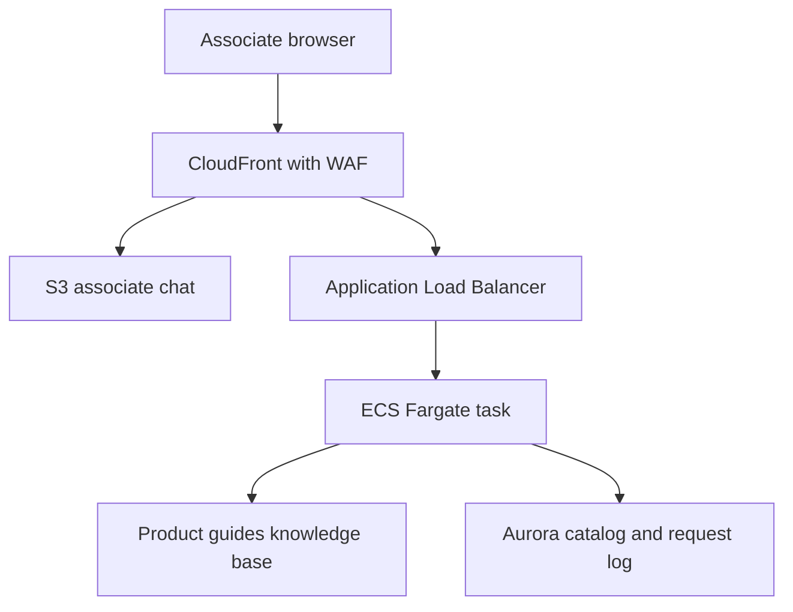
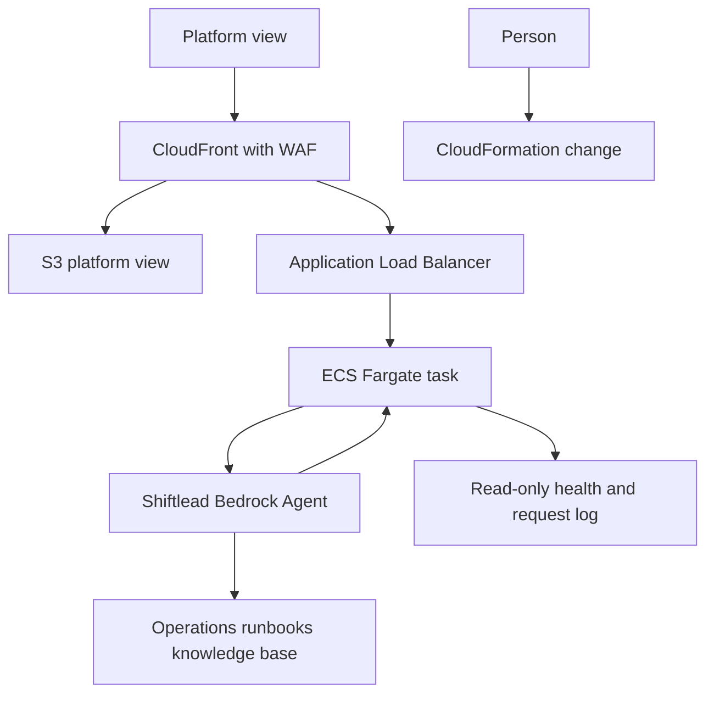

# CounterGuide architecture

This document locks the AWS architecture for the AnyCompany CounterGuide proof of concept.
The CloudFormation templates under `design/cloudformation/` implement this design.
`templates/network.yaml` and `templates/app.yaml` are the previous EC2 pattern.
They are not the source of truth.
This document does not change those files.

## Account and region

Verified from the Cloudathon@UH 2026 workshop page on 7 Nov 2026.
Deploy only into Workshop Studio account `231075364174` as `WSParticipantRole/Participant`.
The deploy region is `us-east-1`.
The workshop page says resources should be deployed in `us-east-1`.
`us-west-2` is only where the pre-provisioned code server already runs.
Leave instance `i-05d938f2fd93600b3`, named `vscodeserver-CodeServer`, and the `vscodeserver` stack untouched in `us-west-2`.
Do not put CounterGuide resources in that VPC.
Do not use the local AWS CLI default profile.
That profile is account `375760496131`, user `AdminFareed`.
It is not the workshop account.
These templates were not deployed.

CloudFront is global.
Its ACM certificate, when a custom name is attached, must be in `us-east-1`.
The deploy region is also `us-east-1`, so the certificate and the rest of the stack share that region.
The CloudFront WAF web ACL uses scope `CLOUDFRONT`, which AWS also requires in `us-east-1`.

## Application

CounterGuide is one application with three tiers: web, application, and data.
Guide chat and Shiftlead stay inside CounterGuide.
This design has no fourth tier and no second application.

## What the current templates do

`templates/network.yaml` builds one VPC across two Availability Zones.
It builds public subnets, private web subnets, private app subnets, and private data subnets.
It creates one NAT gateway in the first public subnet.
The web route table and the app route table both send `0.0.0.0/0` to that NAT gateway.
The data subnets have no internet route.
It creates one S3 gateway endpoint.

`templates/app.yaml` builds a public Application Load Balancer, an EC2 Auto Scaling web tier, an internal Application Load Balancer, an EC2 Auto Scaling app tier, and one RDS MySQL instance.
The web and app tiers use Amazon Linux 2023 launch templates and install packages from user data at boot.
Each Auto Scaling group has a minimum of two instances.
`MultiAZDatabase` defaults to `false`.
The database password is a CloudFormation parameter written into user data.
The site is served over HTTP from the public load balancer DNS name.
That template contains no CloudFront distribution, no WAF, no ECS, no Aurora, no Bedrock, and no ECR.

A later implementation uses `design/cloudformation/` instead of that pattern.
The minimum steady state for the application tier is still two tasks, now on Fargate, not two EC2 instances.

## Web tier

The web tier is a private S3 bucket delivered through CloudFront.
The bucket holds two views of one application: the associate chat, and the Shiftlead platform view.
The browser calls only CloudFront.
It holds no database password and no model credentials.
AWS WAF is attached to the CloudFront distribution with the AWS managed common rule set.
Assumption: CloudFront edge locations are the mechanism for remote customers.
No latency number is claimed.
The distribution uses price class `PriceClass_100`.
Assumption: that price class still serves United States customers from CloudFront edge locations.
The default behavior serves the S3 origin.
The `/api/*` behavior forwards to the load balancer and disables caching.
Viewer traffic uses TLS.
Assumption: no custom domain is available, so the proof of concept uses the CloudFront default hostname and the certificate CloudFront provides for that name.
When a domain name and a hosted zone ID are both supplied, Route 53 aliases the name to CloudFront and ACM issues the certificate in `us-east-1`.

Publishing objects to the web bucket updates the front end.
That publish does not replace Fargate tasks, Aurora, or either knowledge base.

## Application tier

The application tier is one ECS service on Fargate behind one Application Load Balancer.
Tasks run in two private subnets, one subnet in each Availability Zone, with `AssignPublicIp` disabled.
The steady state is at least two tasks.
Availability zone rebalancing is enabled.
Target tracking scales the service on CPU utilization.
The starting target is 50 percent.
That number is a starting setting, not a measured baseline.
The deployment minimum healthy percent is 100 and the maximum percent is 200.
A new task must pass the load balancer health check before an old task is drained.
The database, the static site, and the knowledge bases stay up during that rollout.
The container image comes from ECR.
The service does not use a self-managed EC2 instance.
Fargate is the compute, so the routine operating model does not patch a guest operating system.
ECS Exec is disabled.

This is the only tier that calls Aurora, Bedrock, and the health APIs.
Guide chat retrieves from the product knowledge base, reads the catalog, and calls the model only when retrieval returned documents.
If retrieval finds nothing, the response says so.
Shiftlead is invoked only from this tier.
The task role may read this application's alarms, load-balancer target health, ECS service, Aurora status, knowledge-base ingestion status, application logs, and the request log.
The same role denies infrastructure changes.
There is no automatic remediation.

## Data tier

The data tier is one Aurora PostgreSQL Serverless v2 cluster.
A writer instance runs in the first Availability Zone.
A reader instance runs in the second Availability Zone.
Both use the `db.serverless` class.
`PubliclyAccessible` is false.
The catalog and the request log live in the database `counterguide`.
The application tier creates and changes those tables.
The master password is generated by RDS and stored in Secrets Manager.
The template does not contain a password.

Two Bedrock Knowledge Bases use two private S3 buckets as document sources.
One bucket holds product guides.
The other holds operations runbooks.
Embeddings are stored in Amazon S3 Vectors, one index per knowledge base, in one vector bucket.
The catalog database is not the vector store.
A guide re-ingest does not write the catalog.
OpenSearch Serverless is not part of this design.

Shiftlead is one Bedrock Agent.
Its foundation model parameter defaults to the Amazon Nova Pro inference profile `us.amazon.nova-pro-v1:0`.
Assumption: that is the Nova Pro model from the workshop model-access example, and model access is not confirmed enabled in this account yet.
The agent is associated only with the operations runbooks knowledge base.
Its action group uses `RETURN_CONTROL`.
The application tier executes the read.
The agent has no Lambda and no write tool.
A person ships any change in CloudFormation.

## Network

One VPC.
Two Availability Zones.
Two public subnets for the load balancer and the NAT gateways.
Two private subnets for Fargate.
Two private subnets for Aurora.
No private web subnets.
The web tier is not in the VPC.
Two NAT gateways, one in each public subnet, each with its own Elastic IP.
The Fargate route table in each Availability Zone sends `0.0.0.0/0` to the NAT gateway in that same zone.
The data subnets have no internet route.
One S3 gateway endpoint is associated with both Fargate route tables and the data route table, so S3 object traffic does not depend on NAT.
Bedrock, ECR, Secrets Manager, and CloudWatch APIs use the NAT path.

Security groups chain each hop.
The load balancer allows inbound TCP 80 only from the CloudFront origin-facing prefix list `com.amazonaws.global.cloudfront.origin-facing`.
In `us-east-1` that prefix list ID is `pl-3b927c52`.
The load balancer forwards a request only when the header `X-Origin-Verify` matches the generated secret `counterguide/origin-verify`.
Fargate allows inbound TCP 8080 only from the load balancer security group.
Aurora allows inbound TCP 5432 only from the Fargate security group.
Fargate and Aurora have no public IP and no public route to them.

This proof of concept uses a dedicated network.
Sharing that network with a later application happens only if a later decision says so.

## Change boundaries

A guide update uploads objects to the product-guides bucket and starts ingestion for that knowledge base only.
It does not update `web.yaml` and does not replace the storefront.
A runbook update uploads objects to the runbooks bucket and starts ingestion for that knowledge base only.
It does not redeploy the storefront.
A catalog change is a write through the application tier to Aurora.
It does not start either ingestion and does not publish the web bucket.
An application change is an ECS rolling deployment of the Fargate service.
A front-end change is an object write to the web bucket.

## Request paths

Guide chat.
The associate browser loads the static view from CloudFront and S3.
The chat request uses `/api/*`, which CloudFront sends to the load balancer with the origin header.
The load balancer sends the request to a healthy Fargate task.
The task retrieves from the product knowledge base.
The task reads the catalog from Aurora.
If retrieval is empty, the task says so and does not answer from general model knowledge.
If retrieval returns documents, the task calls Nova Pro with those documents and the catalog rows.
The answer includes the documents used.
A kit request returns real catalog SKUs and refuses a combination the safety guide forbids.
The task writes the request log.
The browser shows the answer.
It does not receive database or model credentials.

Shiftlead.
The platform view loads from CloudFront and S3.
The question uses the same `/api/*` path to a Fargate task.
The task invokes the Shiftlead agent alias.
The agent reads the operations runbooks.
When the agent selects a tool, Bedrock returns control to the task.
The task performs the read: CloudWatch alarms, load-balancer target health, ECS service status, Aurora status, knowledge-base ingestion status, and recent request-log rows.
The task sends that observation back to the agent.
The agent names the tier at fault and a proposed next action.
The platform view shows that proposal.
The agent does not apply it.
A person ships the change by updating CloudFormation.

## Templates

Deploy in `us-east-1` as `WSParticipantRole/Participant` in account `231075364174`.
Do not deploy these stacks.
The intended order, when a later deploy is authorized, is:

1. `design/cloudformation/network.yaml` creates the VPC, subnets, two NAT gateways, and the S3 gateway endpoint.
2. `design/cloudformation/repository.yaml` creates the ECR repository.
   Push the CounterGuide image before the application stack.
3. `design/cloudformation/knowledge.yaml` creates the document buckets, S3 Vectors indexes, both knowledge bases, and the Shiftlead agent.
   This stack does not create the web tier.
4. `design/cloudformation/application.yaml` creates Aurora, the load balancer, the Fargate service, secrets, logs, and alarms.
   It imports the network, repository, and knowledge stacks.
5. `design/cloudformation/web.yaml` creates the static bucket, CloudFront, WAF, and the optional ACM certificate and Route 53 records.

Default stack names are `counterguide-network`, `counterguide-repository`, `counterguide-knowledge`, `counterguide-application`, and `counterguide-web`.
Each template defaults `DeployRegion` to `us-east-1` and refuses any other region or any other account.
Passwords are generated in Secrets Manager.
No template contains a database password.

## Service inventory

| Service | Why it is there | Minimum HA configuration |
|---|---|---|
| Amazon CloudFront | Edge delivery of the static views and the `/api/*` path | One distribution, S3 origin and load balancer origin |
| AWS WAF | Filter on the CloudFront distribution | One CLOUDFRONT web ACL in us-east-1 with the common rule set |
| Amazon S3 | Static front end and the two document sources | Three private buckets, objects stored across Availability Zones by S3 |
| Amazon S3 Vectors | Vector indexes for the two knowledge bases | One vector bucket, two indexes |
| Amazon ECR | CounterGuide container image | One repository in us-east-1. Tasks in both Availability Zones pull it |
| Amazon ECS on Fargate | Application tier, no guest OS to patch | One service, at least two tasks, two private subnets |
| Application Load Balancer | Entry from CloudFront to Fargate | One load balancer in two public subnets |
| Amazon Aurora PostgreSQL Serverless v2 | Catalog and request log | One cluster, writer and reader in two Availability Zones |
| Amazon Bedrock Knowledge Bases | Product guides and operations runbooks | Two knowledge bases, each with its own S3 source |
| Amazon Bedrock Agent | Shiftlead | One agent, one alias, invoked only by the task role |
| NAT Gateway | Private subnet egress to Bedrock and other AWS APIs | Two gateways, one per Availability Zone, each with its own Elastic IP |
| Internet Gateway | Public path for the load balancer and the NAT gateways | One gateway, the standard redundant VPC gateway |
| S3 gateway endpoint | S3 object traffic without NAT | One gateway endpoint on the Fargate and data route tables |
| Security groups | Chain CloudFront to the load balancer, to Fargate, to Aurora | Three groups, ingress only from the previous hop |
| AWS Secrets Manager | Generated database password and the CloudFront origin header | RDS-managed database secret, plus `counterguide/origin-verify` |
| Amazon CloudWatch | Logs and alarms | One application log group, four alarms named `counterguide-*` |
| AWS Certificate Manager | TLS certificate for a custom CloudFront name | One certificate in us-east-1, created only when a domain and hosted zone are supplied |
| Amazon Route 53 | DNS for that custom name | Created only when a domain and hosted zone are supplied |
| AWS CloudFormation | Source of truth for the environment | The five templates in `design/cloudformation/` |
| IAM | Task, execution, knowledge-base, and agent roles | Scoped to this application's resources. The task role denies changes |

## Cost

The main cost drivers are two NAT gateways, public IPv4 addresses, the load balancer, Aurora minimum ACUs, Fargate, and two knowledge bases.
This proof of concept uses a dedicated network.
A later application adds another application service, another database schema, and two knowledge bases.
It does not add a second NAT pair unless a later decision gives it a separate VPC.
Estimate, not a quote and not a measurement in this account: a highly available managed stack is about $210–$228 per month in list price if left running, using public list prices as of 7 Nov 2026.
S3 Vectors is the vector store so this design does not add an OpenSearch Serverless collection per knowledge base.

## Intentionally absent

- A fourth tier or a second application.
- Self-managed EC2 as the primary compute.
- Routine operating-system patching and SSH.
- A single NAT gateway.
- A single-AZ database.
- Amazon OpenSearch Serverless.
- Automatic remediation and account-wide troubleshooting.
- An answer from general model knowledge when retrieval finds nothing.
- Checkout, payments, a full inventory system, and a store locator.
- Training or fine-tuning a foundation model.
- A custom domain and Route 53, until both a domain and a hosted zone exist.
- A measured latency number.
- Resources in the `us-west-2` code-server VPC.
- Use of account `375760496131`.
- A rewrite of `templates/network.yaml` or `templates/app.yaml`.
- Hand-built console resources as the source of truth.
- An identity provider. The problem statement does not specify one.

## Related files

- `architectural-assessment.md` — review of this design, including what stays in scope and what waits
- `assumptions.md` — verified boundaries and assumptions
- `requirements-trace.md` — core requirements and pain points mapped to this design
- `cloudformation/network.yaml` — VPC, two NAT gateways, S3 gateway endpoint
- `cloudformation/repository.yaml` — ECR repository
- `cloudformation/knowledge.yaml` — document buckets, knowledge bases, Shiftlead agent
- `cloudformation/application.yaml` — Aurora, Fargate, load balancer, secrets, alarms
- `cloudformation/web.yaml` — S3 web bucket, CloudFront, WAF, optional ACM and Route 53
- `../problem-statement/concept.md` — proof-of-concept scope
- `../problem-statement/sample-application.md` — CounterGuide, Guide chat, and Shiftlead
- `../problem-statement/core-requirements.md` — mandatory outcomes
- `../templates/network.yaml` — previous network pattern, not the source of truth
- `../templates/app.yaml` — previous EC2 pattern, not the source of truth
